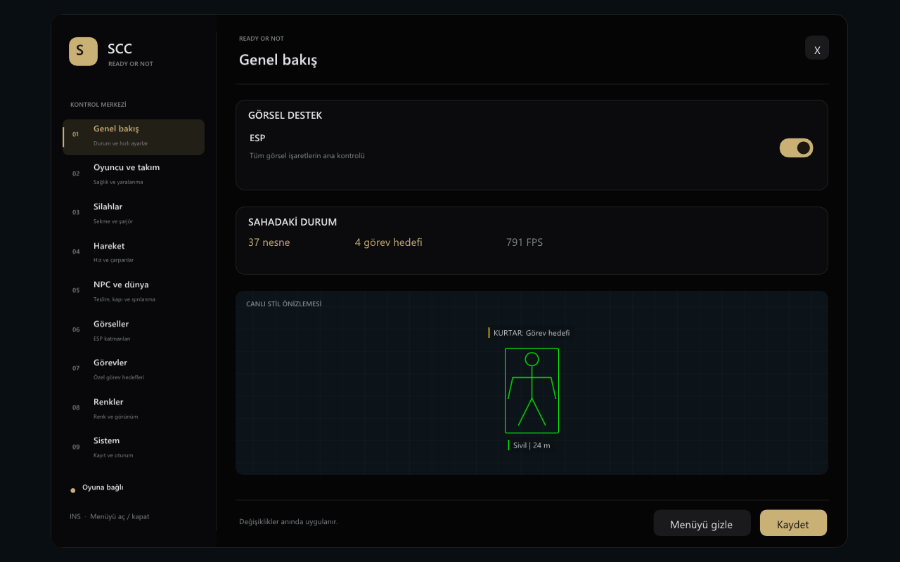
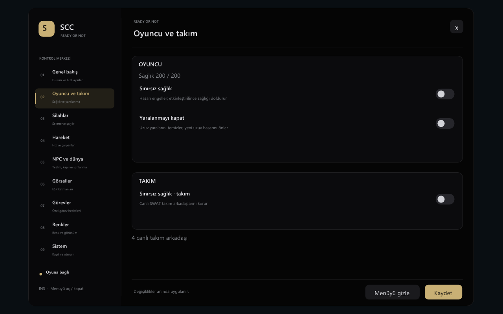
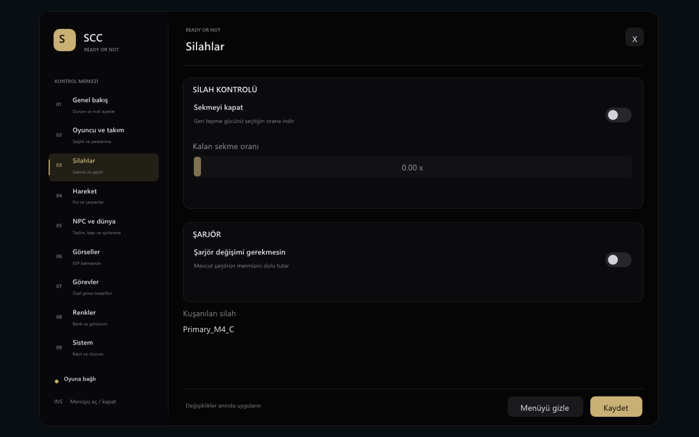
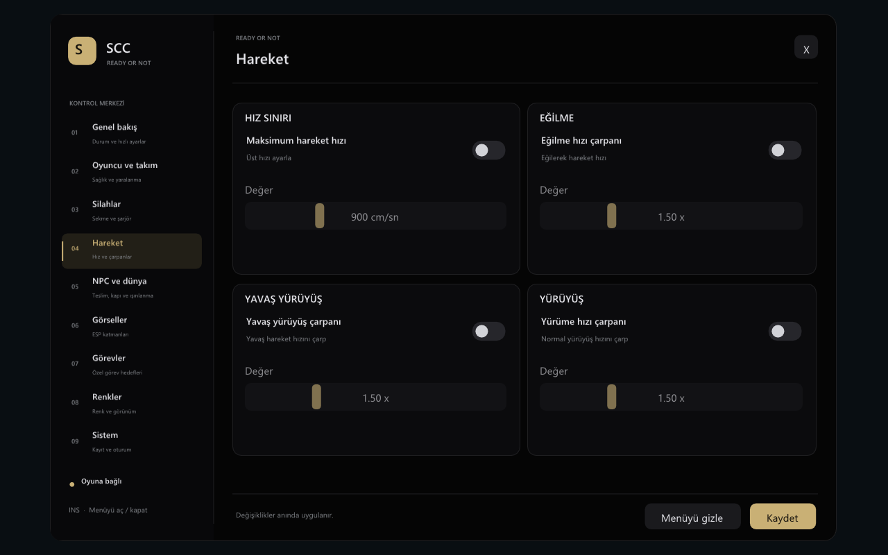
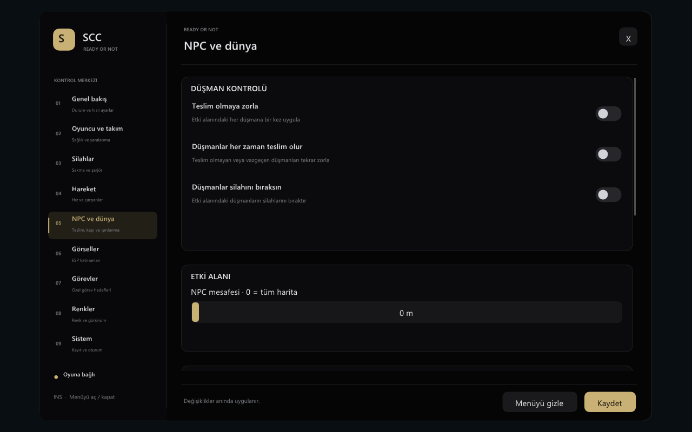
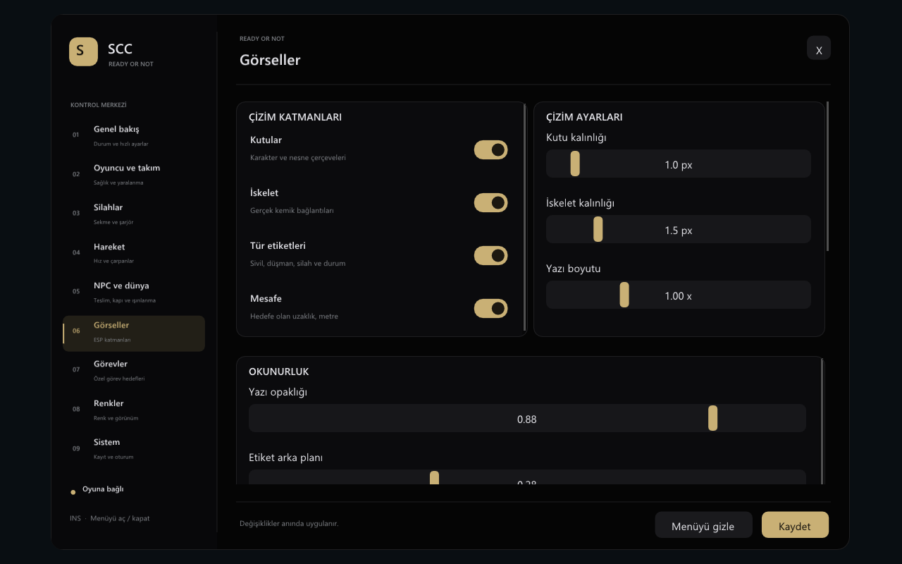
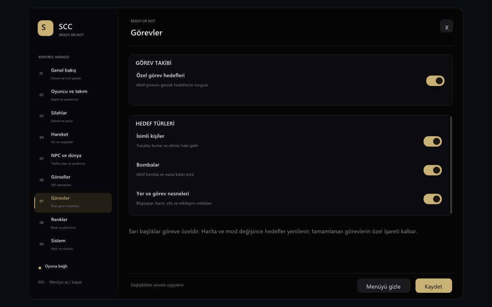
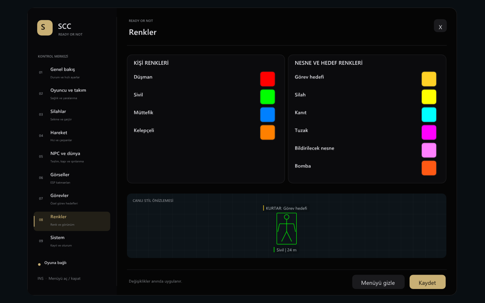
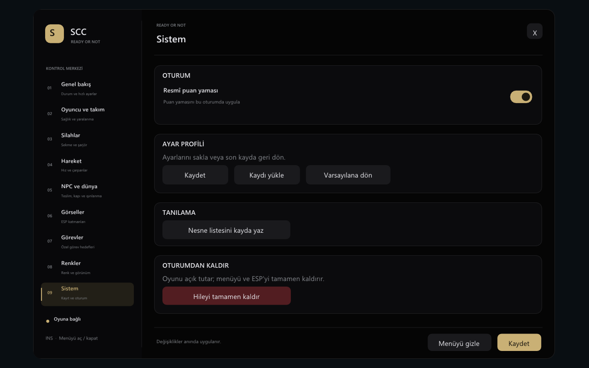

# SCC — Ready or Not

**Türkçe** · [English](README.md)

SCC, Steam sürümündeki **Ready or Not** için yapılandırılabilir oyun içi kontrol paneli ve ESP sistemidir. x64 internal DLL, Dear ImGui DirectX 11/12 arayüzü, dinamik görev hedefi keşfi, kalıcı profil ve güvenli temizlik akışını bir araya getirir.

> Steam build `25784851` sürümüne kilitlidir. Eğitim, çevrimdışı, tek oyunculu veya yalnız oturum sahibinin izin verdiği özel oturumlar içindir. VOID Interactive ile bağlantılı değildir ve anti-cheat atlatma içermez.

Proje [Herkkomehtala/ReadyOrNot-Internal](https://github.com/Herkkomehtala/ReadyOrNot-Internal) temelinden başlamış; yeni overlay, oyun kontrolleri, görev modeli, testler ve başlatıcıyla büyük ölçüde güncellenmiştir.

## Menü önizlemeleri



| Oyuncu ve takım | Silahlar |
|---|---|
|  |  |

| Hareket | NPC ve dünya |
|---|---|
|  |  |

| Görsel filtreler | Görev hedefleri |
|---|---|
|  |  |

| ESP renkleri | Sistem |
|---|---|
|  |  |

## Özellikler

### Oyuncu ve takım

- Yapılandırılabilir sınırsız oyuncu sağlığı
- Yaralanmayı engelleme ve uzuv yaralarını temizleme
- Yaşayan SWAT takım arkadaşları için sınırsız sağlık

### Silah ve hareket

- Açılıp kapanabilen, kalan sekme oranı ayarlı geri tepme kontrolü
- Aktif şarjörü dolu tutma; silah değişimi/kaldırmada güvenli geri yükleme
- Maksimum temel hareket hızı
- Ayrı eğilme, yavaş yürüyüş ve yürüyüş çarpanları

### NPC ve dünya

- Düşmanları bir kez veya sürekli teslim olmaya zorlama
- Düşmanların silah bırakmasını sağlama
- Yakın alan veya tüm harita için yapılandırılabilir etki mesafesi
- Taranan kapı kilitlerini açık tutma ve oturuma ait değişiklikleri kapatınca geri verme
- Seçilen NPC'ye gitme veya NPC'yi oyuncunun yanına getirme

### ESP ve görevler

- Kutu, sadeleştirilmiş iskelet, tür/isim etiketi ve mesafe
- Düşman, sivil, müttefik, silah, kanıt, tuzak ve bildirilecek nesne filtreleri
- Tabanca ve uzun namlulu silahlar; envanterdeki/eldeki/müttefik silahları elenir
- Dinamik tutukla/kurtar hedefleri, bombalar, bilgisayar/terminal ve yer/bildirim hedefleri
- Tamamlanan, başarısız, gizli veya ilgisiz hedeflerin özel işaretleri kaldırılır
- Çizgi kalınlığı, yazı ölçeği, opaklık, etiket zemini ve çakışma azaltma
- Kategori başına renk düzenleyici ve stil önizlemesi

### Arayüz ve yaşam döngüsü

- `Insert` ile açılan dokuz sayfalı SCC menüsü
- Menü açıkken fare kontrolü; gizlenince oyun girdisinin geri verilmesi
- Profil kaydetme, yeniden yükleme ve varsayılana dönme
- Oyunu kapatmadan Sistem sayfasından güvenli kaldırma
- Yüklemeden önce oyun hash'i ve canlı SDK adresi doğrulaması

## Hızlı kurulum

1. Reponun **Releases** sayfasından `SCC-ReadyOrNot-<sürüm>.zip` dosyasını indir.
2. Arşivin tamamını kalıcı bir klasöre çıkart.
3. Ready or Not'ı Steam üzerinden açıp ana menüyü bekle.
4. `SCC-ReadyOrNot-Aktif-Et.cmd` dosyasını çalıştır.
5. Başlatıcının HUD bağlantısını ve ImGui çizimini doğrulamasını bekle.
6. SCC menüsünü açıp kapatmak için `Insert` tuşunu kullan.
7. Profili **Sistem → Kaydet** ile sakla.
8. Güncelleme/silme öncesinde **Sistem → Hileyi tamamen kaldır** düğmesini kullan.

Başlatıcı bilinmeyen oyun sürümünü veya geçersiz canlı adresleri reddeder. Bu kontrolleri kaldırma.

Ayrıntılar için [Türkçe kurulum ve sorun giderme rehberine](docs/INSTALLATION.tr.md) bak.

## Kaynak koddan derleme

Gereksinimler:

- Windows 10/11 x64
- Visual Studio 2022 C++ Build Tools, MSVC v143 ve Windows SDK
- PowerShell 5.1 veya üzeri

```powershell
.\Build-RoN.ps1
```

Çıktı:

```text
x64\Release\SCC-ReadyOrNot.dll
```

Yalnız okuma uyumluluk kontrolü:

```powershell
.\Activate-RoN.ps1 -CheckOnly
```

## Testler

```powershell
.\test\run-esp-tests.cmd
.\test\run-weapon-tests.cmd
.\test\run-gameplay-tests.cmd
.\test\run-menu-tests.ps1
```

Menü test sistemi gerçek, gizli bir DirectX aygıtıyla bütün sayfaları PNG olarak üretir; Insert kontrolünü, yeniden boyutlandırmayı, kaydet/yükle/varsayılan komutlarını, menü gizliyken ESP'yi ve güvenli kaldırmayı doğrular.

## Ayarlar ve kayıtlar

- Profil: `x64\Release\SCC-ReadyOrNot.ini`
- Kayıt: `x64\Release\SCC-ReadyOrNot.log`
- Menü tuşu: `Insert`
- Geliştirici temiz kaldırma: `.\Activate-RoN.ps1 -Unload`

## Lisans ve katkılar

MIT. Dear ImGui, MinHook ve oluşturulan SDK kendi bildirimlerini korur; [THIRD_PARTY.md](THIRD_PARTY.md) dosyasına bak. Herkkomehtala, Dumper-7 ve özgün bileşen geliştiricilerine teşekkürler.

